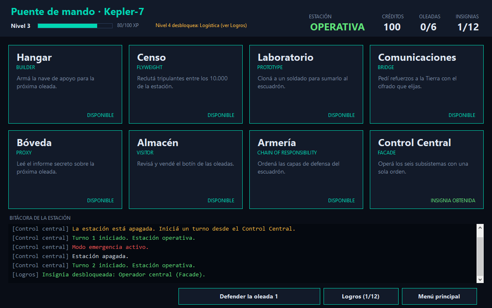
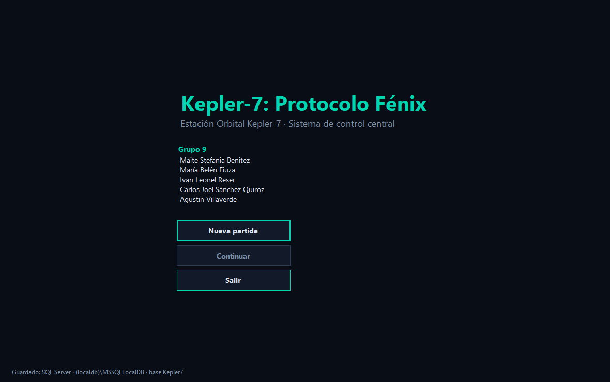
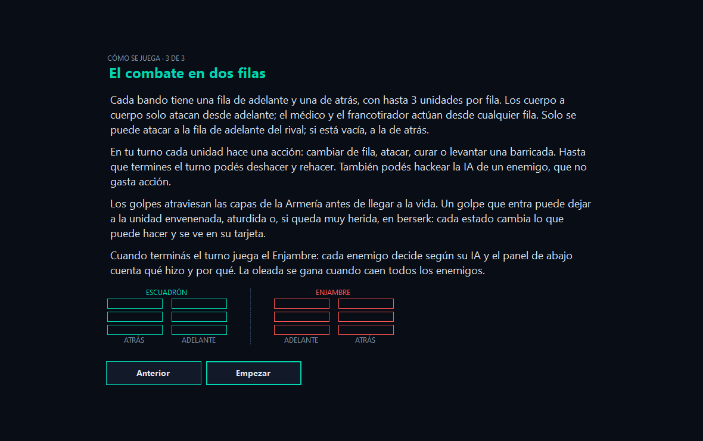
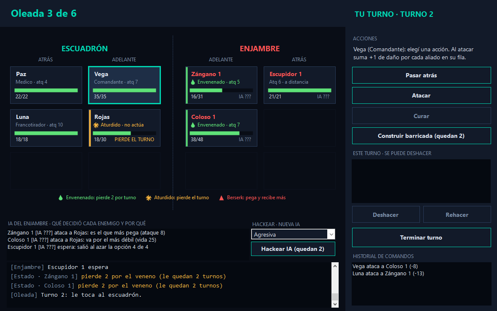
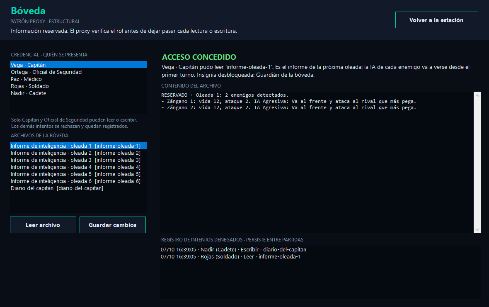
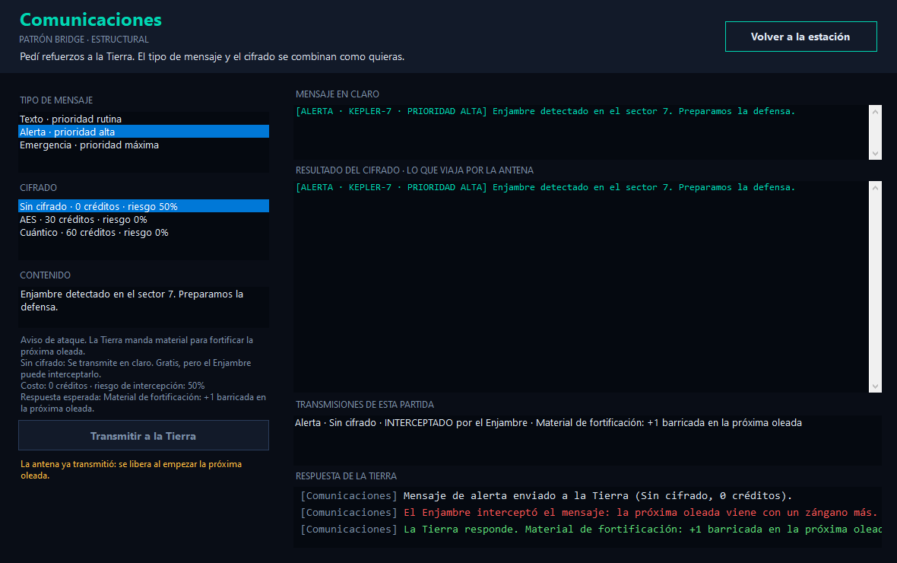
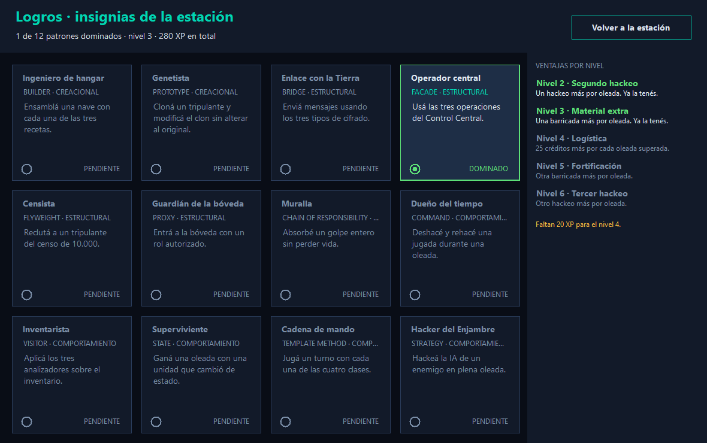

# Kepler-7: Protocolo Fénix

Videojuego táctico por turnos en C# Windows Forms que implementa doce patrones de diseño como mecánicas de juego. Trabajo Práctico Final - *Kepler-7: El universo de los patrones* (UAI, T1-23-32 Trabajo de Diploma).

**Grupo 9:** Maite Stefania Benitez · María Belén Fiuza · Ivan Leonel Reser · Carlos Joel Sánchez Quiroz · Agustin Villaverde



## El juego

El Enjambre ataca la estación orbital Kepler-7 en seis oleadas. Antes de cada una preparás al escuadrón en el puente de mando y después la defendés en un combate por turnos en dos filas. Si aguantás las seis, la estación se salva; si cae todo el escuadrón, Kepler-7 se apaga.

Cada módulo de la estación es un patrón de diseño en uso, y el combate usa otros cinco:

| Módulo o mecánica | Patrón | Qué hace |
|---|---|---|
| Hangar | Builder | Arma la nave de apoyo de la próxima oleada con una de tres recetas |
| Censo | Flyweight | 10.000 tripulantes con cinco objetos de especie; de ahí se recluta |
| Laboratorio | Prototype | Clona a un soldado y entrena al clon sin tocar al original |
| Comunicaciones | Bridge | Mensajes a la Tierra que combinan tipo y cifrado; la Tierra responde con refuerzos |
| Bóveda | Proxy | Informes reservados solo para roles autorizados, con registro de rechazos |
| Almacén | Visitor | Analiza el botín: valor, conteo de armas o envenenarlas |
| Armería | Chain of Responsibility | Las capas que atraviesa cada golpe: Esquiva, Bloqueo, Armadura, Escudo y Vida |
| Control Central | Facade | Inicia el turno, declara la emergencia y apaga la estación coordinando seis subsistemas |
| Acciones del turno | Command | Cada acción se puede deshacer y rehacer hasta terminar el turno |
| Estados de las unidades | State | Normal, Envenenado, Aturdido y Berserk |
| Turno de cada clase | Template Method | Las mismas etapas con pasos distintos por clase |
| IA de los enemigos | Strategy | Agresiva, Defensiva, Aleatoria y Calculadora; se puede hackear |

Hay tutorial, XP, niveles con desbloqueos, créditos, doce insignias (una por patrón), pantalla final con el resumen y sonido.

## Requisitos

- Windows 10/11
- Para jugar: [.NET 8 Desktop Runtime](https://dotnet.microsoft.com/download/dotnet/8.0)
- Para compilar: .NET 8 SDK (o superior)
- SQL Server LocalDB (viene con Visual Studio) o SQL Server Express, para guardar el progreso. Sin servidor el juego funciona igual, con el progreso en memoria

## Instalar

1. Descargar `Kepler7-Setup-1.0.0.exe` de la última versión desde [Releases](https://github.com/ivan-leonel-reser/Kepler7/releases).
2. Ejecutarlo y seguir los pasos. Se instala para el usuario actual, sin permisos de administrador, y crea los accesos directos en el menú Inicio y en el escritorio.
3. Abrir Kepler-7 desde el menú Inicio. No hace falta Visual Studio.

El instalador avisa si falta el .NET 8 Desktop Runtime y ofrece abrir la página de descarga. El paso a paso con capturas, la configuración de la base y la desinstalación están en el manual de instalación (PDF), que se descarga de la misma página y también queda en el menú Inicio.

Sin instalador: descargar el `.zip` de la misma versión, descomprimirlo en cualquier carpeta y ejecutar `Kepler7.Game.exe`.

## Compilar y ejecutar desde el código

```bash
dotnet build Kepler7.sln
dotnet test
dotnet run --project src/Kepler7.Game
```

Para generar el ejecutable de distribución:

```bash
dotnet publish src/Kepler7.Game -c Release -r win-x64 --self-contained false -o publicar
```

El instalador se arma con [Inno Setup 6](https://jrsoftware.org/isinfo.php) a partir de esa carpeta (`ISCC.exe` está en la carpeta donde se instaló Inno Setup):

```bash
ISCC instalador/Kepler7.iss
```

Queda en `instalador/salida`. Si en `publicar` hay un archivo `Manual de instalacion.pdf`, el instalador lo incluye y le crea un acceso directo.

## Persistencia

El progreso (XP, créditos, oleadas superadas e insignias) y el registro de accesos de la Bóveda se guardan en SQL Server con seguridad integrada.

1. La cadena de conexión está en `appsettings.json`, al lado del ejecutable (en el código, `src/Kepler7.Game/appsettings.json`). Por defecto apunta a `(localdb)\MSSQLLocalDB`. Para SQL Server Express cambiarla por `Server=.\SQLEXPRESS;Database=Kepler7;Integrated Security=true;TrustServerCertificate=true`.
2. Al arrancar, el juego crea la base `Kepler7` y sus tablas si no existen, con el script `db/01_crear_base.sql`. El mismo script se puede correr a mano:

```bash
sqlcmd -S "(localdb)\MSSQLLocalDB" -E -i db/01_crear_base.sql
```

Si no se puede conectar, el juego lo avisa en la pantalla de inicio y sigue funcionando con el progreso en memoria, que se pierde al cerrar.

Las pruebas de la capa de datos usan una base aparte, `Kepler7_Pruebas`, y quedan como no concluyentes si no hay SQL Server. La cadena se puede cambiar con la variable de entorno `KEPLER7_SQL_PRUEBAS`.

## Estructura

La solución está organizada en cinco capas:

| Proyecto | Capa | Contenido |
|---|---|---|
| `src/Kepler7.BE` | Entidades | Lo que se guarda y viaja entre capas: progreso, insignias, entradas de bitácora, intentos de acceso y los contratos de persistencia |
| `src/Kepler7.Services` | Servicios transversales | Azar inyectable y bitácora |
| `src/Kepler7.DAL` | Acceso a datos | Repositorios en SQL Server y en memoria que implementan los contratos de BE |
| `src/Kepler7.Core` | Lógica de negocio | Reglas del juego y los 12 patrones de diseño, sin dependencias de UI |
| `src/Kepler7.Game` | Interfaz | Windows Forms: dibuja, captura la entrada y llama a Core |

Además están `tests/Kepler7.Tests` (pruebas automatizadas, incluidas las de dependencias entre capas), `db/` (script de creación de la base) e `instalador/` (script de Inno Setup).

Dependencias entre capas, tal como las declaran los `ProjectReference`:

`Game -> Core, BE, Services` · `Core -> DAL, BE, Services` · `DAL -> BE, Services` · `Services -> BE` · `BE` no referencia a ninguna otra.

La interfaz no referencia a la capa de datos: los repositorios se los pide a Core. La lógica y los patrones viven en `Kepler7.Core`, que no referencia a Windows Forms. Los patrones están en `src/Kepler7.Core/Patrones/<Familia>/<Patron>/`, con los nombres que pide la consigna.

## Pruebas

`dotnet test` corre las pruebas de cada patrón, del combate, de la partida completa, de la persistencia y de la arquitectura. También corren en GitHub Actions en cada pull request.

## Capturas

| | |
|---|---|
|  |  |
|  |  |
|  |  |
